# Battlefield Refractor Blender

A Blender 5.2+ toolset for importing, editing, and exporting assets used by
Battlefield 2, Battlefield 2142, and other games built on DICE's Refractor 2
engine.

> [!IMPORTANT]
> This repository is a modernized fork of
> [marekzajac97/bf2-blender](https://github.com/marekzajac97/bf2-blender).
> It intentionally drops support for Blender versions older than 5.2 and may
> not remain compatible with files or workflows from older add-on releases.

The add-on is under active development. Back up production assets before
migrating them to a new version.

## Changes from upstream

The comparison below describes this fork relative to upstream `main` at the
time it was forked. Upstream may continue to change independently.

| Area | Upstream at fork point | This fork |
| --- | --- | --- |
| Blender support | Blender 4.2 minimum, Blender 5.2 recommended | Blender 5.2 minimum |
| Blender APIs | Compatibility branches for several Blender generations | Direct use of Blender 5.2 Action Slots, Geometry Nodes modifier inputs, native DDS loading, and current rendering APIs |
| Mesh and image processing | Primarily Python and BMesh-oriented data transfer | NumPy arrays and Blender bulk `foreach_get`/`foreach_set` operations for mesh, image, UV, animation, heightmap, and lightmap data |
| DDS export | Platform-specific Texconv Custom DLL | Platform-independent, NumPy-accelerated Python encoder |
| DDS formats | Texconv-backed conversion | Uncompressed RGBA, DXT1, DXT3, and DXT5 with generated mipmaps |
| Rectangle packing | Vendored `rectpack` package | In-house deterministic MaxRects packer with multi-bin and power-of-two atlas support |
| Distribution | Separate platform packages containing native libraries | One platform-independent add-on package |
| Import defaults | Full mesh hierarchies and referenced collision data imported by default | Optional collision meshes, occluders, LODs, and damage states default to Off, with On and Hidden collection modes |
| Level loading | Experimental unpacked, lightmapping-oriented scene setup | Direct packed or unpacked visual map import with static objects, overgrowth, detailed primary terrain, all terrain clusters, compiled roads, water, and lighting |

The Texconv Git submodule, native binaries, binary dependency licenses, and
vendored `rectpack` source have been removed.

## Requirements

- Blender 5.2 LTS or newer.
- Battlefield 2, Battlefield 2142, or another compatible Refractor 2 asset set.
- A configured game installation or additional mod directory when resolving
  related objects and textures.

NumPy is included with Blender 5.2; no separate Python environment or package
installation is required.

## Supported assets

### Import and export

- Skeleton (`.ske`)
- Animation (`.baf`)
- StaticMesh (`.staticMesh`), including lightmap samples
- SkinnedMesh (`.skinnedMesh`)
- BundledMesh (`.bundledMesh`)
- CollisionMesh (`.collisionMesh`)
- Occlusion mesh (`.occ`)

### Authoring tools

- ObjectTemplate import and export
- Packed and unpacked visual level import
- Level-aware lightmap baking
- Skeleton rigging and animation utilities
- StaticMesh and Overgrowth LOD generation
- SkinnedMesh and BundledMesh skinning
- Native DDS texture import
- DXT1, DXT3, DXT5, and uncompressed DDS export
- Batched lightmap baking and atlas generation

See the [full user documentation](docs/README.md),
[level and map import guide](docs/MAP_IMPORT.md),
[Battlefield 2142 notes](docs/BF2142.md),
[Battlefield 2 glossary](docs/BF2.md), and
[Refractor 2 file format reference](docs/FILE_FORMATS.md) for workflow and
tool-development details.

## Retail asset examples

### Battlefield 2

These Blender 5.2 renders were produced through the add-on's public import
operators from retail Battlefield 2 assets:

<table>
  <tr>
    <th>Weapon: USRIF M16A2</th>
    <th>Character: US light soldier</th>
  </tr>
  <tr>
    <td>
      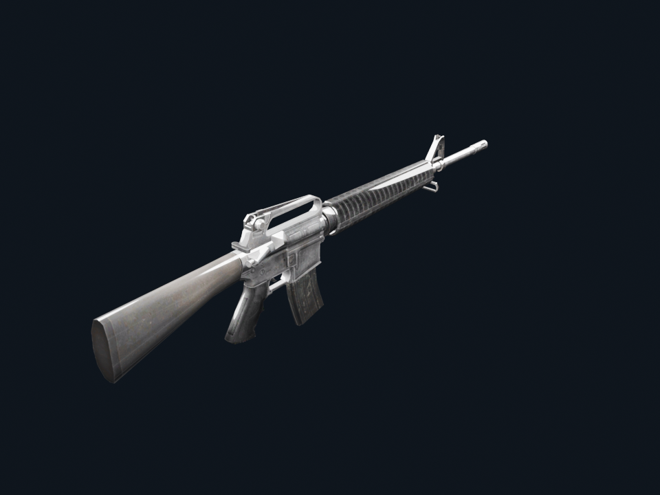
    </td>
    <td>
      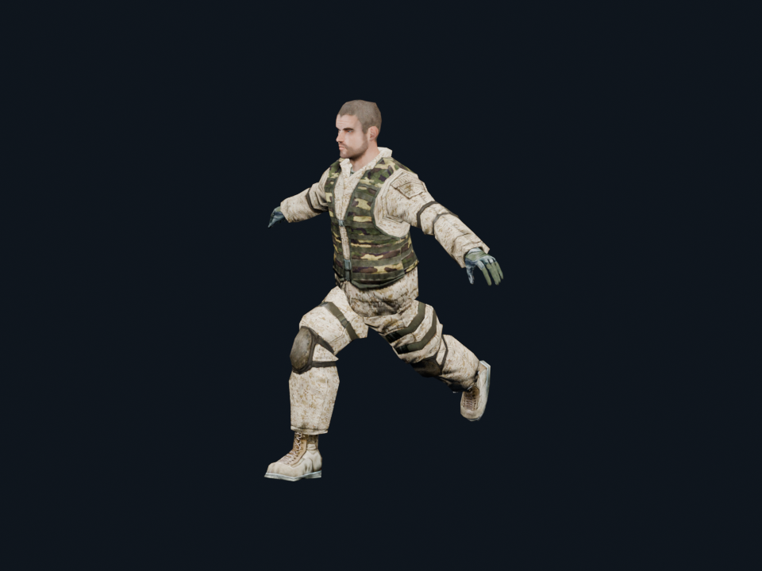
    </td>
  </tr>
  <tr>
    <th>Prop: large trash dumpster</th>
    <th>Vehicle: JEEP FAAV</th>
  </tr>
  <tr>
    <td>
      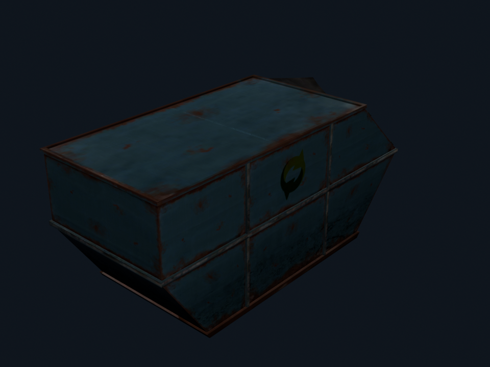
    </td>
    <td>
      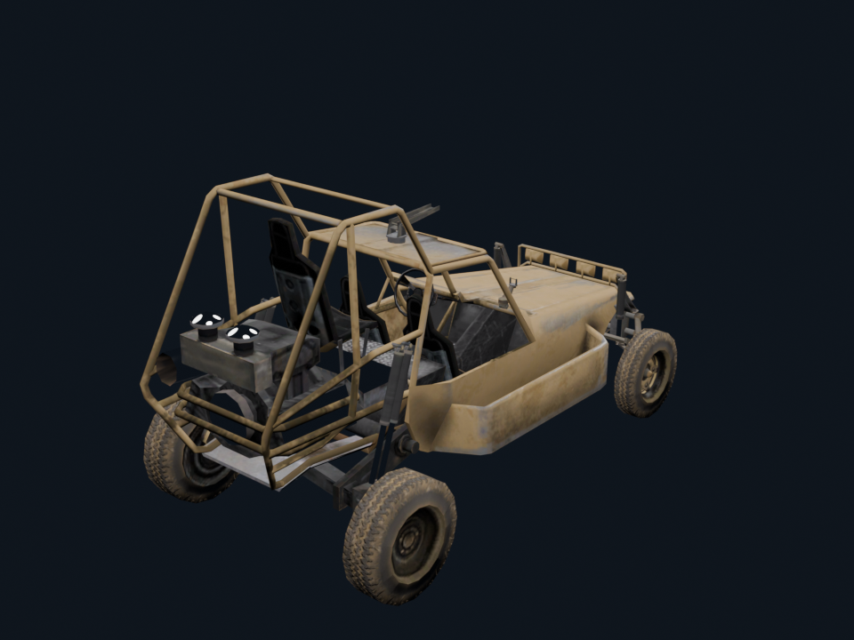
    </td>
  </tr>
</table>

The character example combines the third-person skeleton, skinned mesh, and
`3p_runForward.baf` action:

<p align="center">
  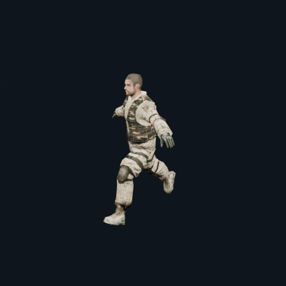
</p>

### Battlefield 2142

These Blender 5.2 renders use the same public import APIs with retail
Battlefield 2142 assets:

<table>
  <tr>
    <th>Weapon: PAC assault rifle</th>
    <th>Character: PAC light soldier</th>
  </tr>
  <tr>
    <td>
      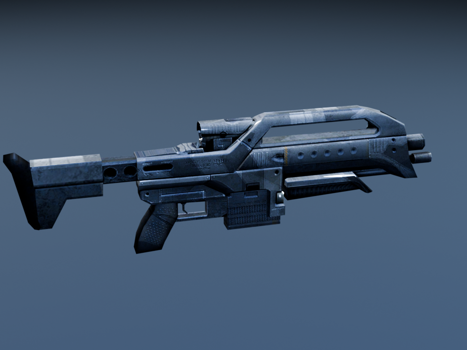
    </td>
    <td>
      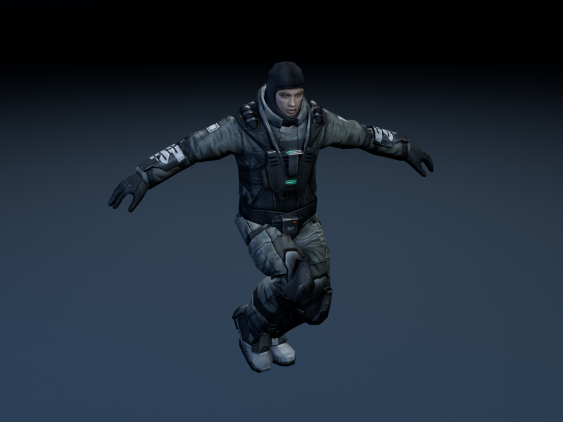
    </td>
  </tr>
  <tr>
    <th>Prop: freezer</th>
    <th>Vehicle: PAC hover tank</th>
  </tr>
  <tr>
    <td>
      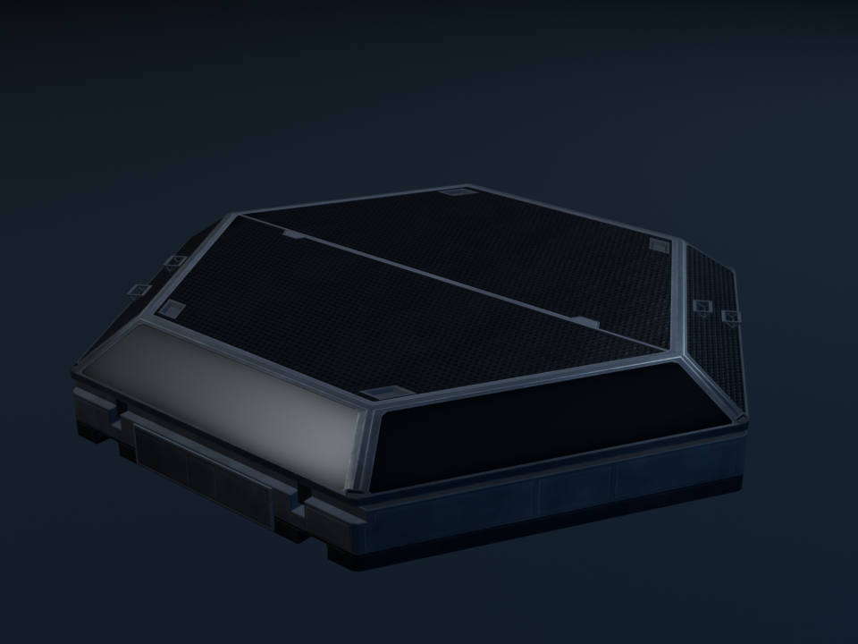
    </td>
    <td>
      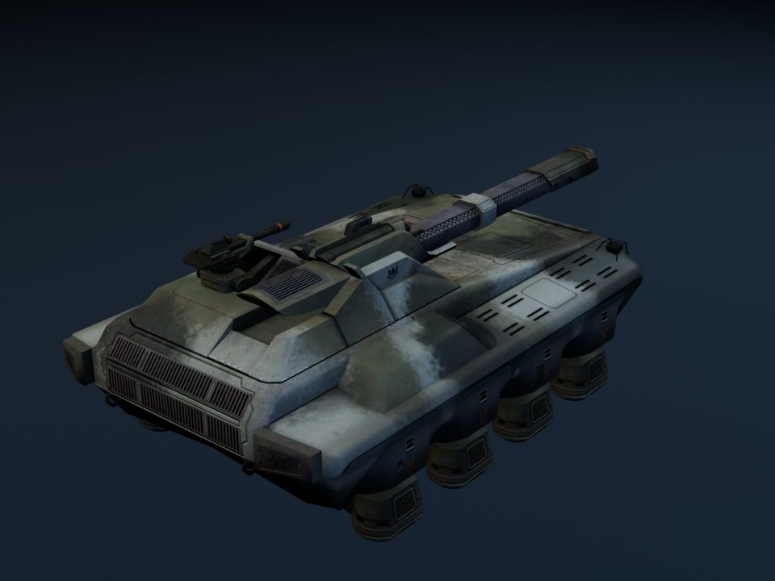
    </td>
  </tr>
  <tr>
    <th>Vehicle: PAC battle walker walk cycle</th>
    <th>Vehicle: EU battle walker walk cycle</th>
  </tr>
  <tr>
    <td>
      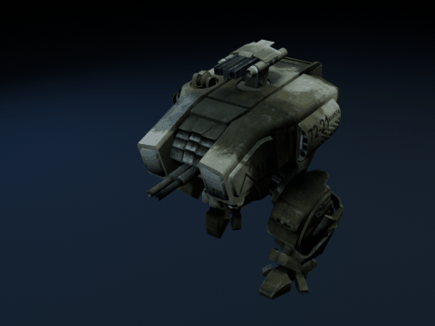
    </td>
    <td>
      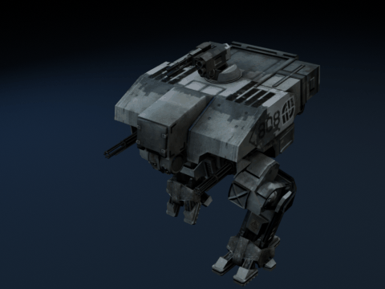
    </td>
  </tr>
</table>

The character combines the PAC third-person SkinnedMesh, `3p_setup.ske`
skeleton, and `3p_runforward.baf` action. The freezer exercises the BF2142
StaticMesh `envmap` fallback. The hover tank and battle walkers demonstrate
articulated ObjectTemplate import and automatic selection of their complete
Geom1 exterior states. For both walkers, the importer also loads the declared
bundle skeleton, constrains each rigid geometry part to its `boneIndex`, and
plays the original 24 FPS walk action.

## Installation

### Install a release

1. Download an `io_scene_bf2-*.zip` package from this fork's
   [Releases](https://github.com/Tzeentchnet/Battlefield-Refractor-Blender/releases).
2. Open Blender 5.2.
3. Drag the ZIP onto Blender, or use
   `Edit > Preferences > Add-ons > Install from Disk`.
4. Enable the **Battlefield Refractor Blender** add-on if Blender does not enable it
   automatically.

### Build from source

Clone this repository and run Blender's extension builder from the repository
root:

```powershell
blender --command extension build --source-dir io_scene_bf2
```

If `blender` is not on `PATH`, invoke the Blender executable by its full path.
Install the generated ZIP using the same steps as a release package.

## Initial setup

Before importing complete objects or levels:

1. Open `Edit > Preferences > Add-ons > Battlefield Refractor Blender > Preferences`.
2. Set the **Battlefield 2** and/or **Battlefield 2142** installation folder.
   The add-on resolves their `mods/bf2` and `mods/bf2142` asset directories
   automatically.
3. Add custom or dependency mods under **Additional mod directories** when
   necessary.

The level importer reads retail `client.zip`, `server.zip`, and mod object
archives directly. Extract archives only for workflows that select individual
ObjectTemplate files and need neighboring files on disk.

Raw mesh, skeleton, animation, collision, and occlusion files can also be
imported individually from `File > Import > Battlefield 2 / 2142` or by
dragging supported files into the viewport.

Detailed setup instructions are available in
[Initial Add-on setup](docs/README.md#initial-add-on-setup).

## Battlefield 2142 notes

For Battlefield 2142, select the installation folder containing `BF2142.exe`;
the add-on derives `mods/bf2142` automatically. Retail BF2142 object archives
use nested mounts such as `Objects\Common` and include Northern Strike
`*_bp1_*` archives. The retail archive configuration files mount these
automatically.

BF2142 uses the shared import operators and defaults. Older retail mesh
versions are supported on import, while export writes the add-on's current
mesh versions. StaticMesh `envmap` techniques import their base material but
do not reproduce the engine-specific reflection. Retail CollisionMesh version
`0.8` is not currently supported; versions `0.9` and `0.10` are supported.
When multiple BundledMesh Geoms cover the same ObjectTemplate parts, the
importer prefers the candidate with more LODs. This selects the complete
four-LOD Geom1 exterior for the PAC and EU battle walkers.

See [Battlefield 2142 notes](docs/BF2142.md) for verified format versions,
archive behavior, material differences, and export caveats.

## Import defaults

The add-on preferences define the default handling for collision meshes,
occluders, lower-detail LODs, and damage states. Each setting has three modes:

- **Off** skips the optional data. For mesh hierarchies this imports only
  the primary Geom and LOD0. Raw mesh imports use Geom0; ObjectTemplate
  imports select the Geom that best covers the template's authored geometry
  parts.
- **On** preserves the previous behavior and imports the data normally.
- **Hidden** imports the data into a dedicated collection with viewport and
  render visibility disabled.

All four settings default to **Off**. Mesh and ObjectTemplate import dialogs
provide per-import overrides initialized from these preferences. Explicitly
selecting a raw `.collisionMesh` or `.occ` file always imports that file.

## Full map import

Use `File > Import > Battlefield 2 / 2142 > Level / Map`, then select a level
directory or its `client.zip`/`server.zip`. The importer auto-detects packed
and unpacked Battlefield 2 and Battlefield 2142 maps. Its default visual
import includes:

- `StaticObjects.con` placements and bundled child objects;
- overgrowth placements;
- Geom0/LOD0 visible meshes with archive-backed DDS materials;
- the detailed primary terrain and all eight surrounding heightmap clusters;
- compiled road meshes with game-matched layering, UV, alpha, and fade behavior;
- a map-wide water plane at the configured sea level; and
- sun and world lighting derived from `Sky.con`.

Imported archive textures are cached locally and packed into the Blender file.
The map collections and scene carry `bf2_*` source metadata.

The playable primary terrain combines its patch colormaps, two RGB material
mask sets, and up to six tiled detail materials from `terraindata.raw`.
Tri-planar rock layers use their side textures on slopes. Generated colormap
and mask atlases are cached and packed into the `.blend`. Each surrounding
tile uses its authored `Colormaps/tx_s#.dds` image, preserving the map-specific
outer landscape instead of applying a generic fallback.

### Retail map examples

<table>
  <tr>
    <th>Strike at Karkand</th>
    <th>Daqing Oilfields</th>
  </tr>
  <tr>
    <td>
      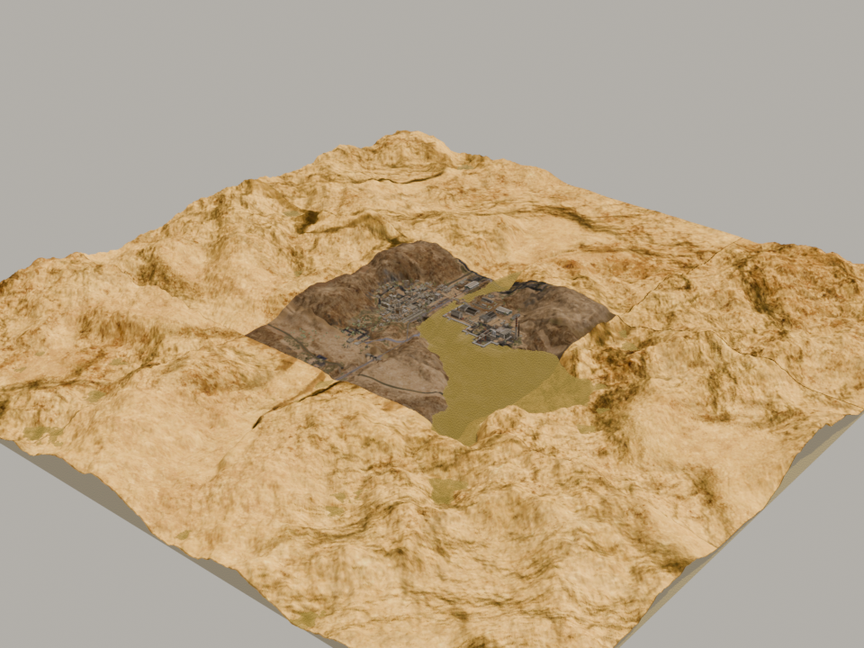
    </td>
    <td>
      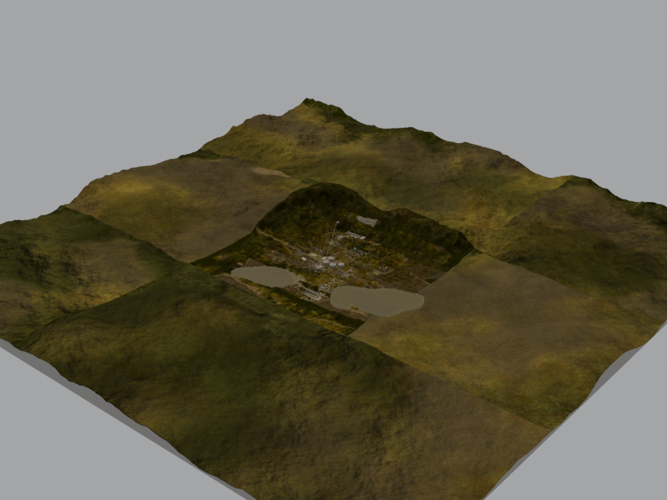
    </td>
  </tr>
</table>

Karkand's `tarmac1_compiled` road demonstrates the reconstructed terrain
detail layers, alpha-blended road edges, and corrected road-to-heightfield
alignment:

<p align="center">
  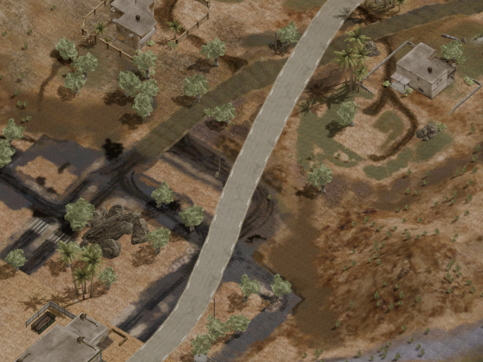
</p>

This is a complete **visual/editor scene** import, not a playable-level
conversion. Gameplay logic, AI/navigation data, spawn logic, collision-only
geometry, occluders, particle/effect systems, camera-distance terrain
transitions, terrain environment maps, sky domes, and fog volumes are not
recreated. See the
[level and map import guide](docs/MAP_IMPORT.md) for details.

## DDS behavior

Blender 5.2 loads DDS textures directly; this fork does not convert textures to
an intermediate image format during import.

DDS export is implemented entirely in Python and NumPy. The encoder:

- writes legacy DDS headers compatible with Battlefield 2;
- supports uncompressed RGBA, DXT1, DXT3, and DXT5;
- creates a complete mipmap chain;
- handles images whose dimensions are not multiples of four;
- uses batched block compression and atomic file replacement.

No external texture converter or native library is required.

## Development

Run the platform-independent unit tests:

```powershell
python -m unittest discover -s tests -v
```

Run the Blender integration checks:

```powershell
blender --background --factory-startup --python tests/blender_integration.py
```

Validate or build the extension manifest:

```powershell
blender --command extension validate io_scene_bf2
blender --command extension build --source-dir io_scene_bf2
```

The integration test covers add-on registration, batched mesh creation,
heightmap topology, compiled-road layering, detailed terrain atlas generation,
DDS encoding, Blender-native DDS loading, and file-based DDS conversion.
Optional arguments allow testing extracted Battlefield 2 or Battlefield 2142
DDS, StaticMesh, BundledMesh, CollisionMesh, and ObjectTemplate files.

## Project status and compatibility

- Add-on version: `0.21.0`
- Minimum Blender version: `5.2.0`
- Package type: Blender extension
- Native runtime dependencies: none

Projects saved after using Blender 5.2-only features may not open correctly in
older Blender versions. This fork does not attempt to preserve Blender 4.x
compatibility.

## Upstream and contributing

The original project and its history are maintained at
[marekzajac97/bf2-blender](https://github.com/marekzajac97/bf2-blender).

Changes specific to Blender 5.2 modernization, the Python DDS encoder, or the
in-house rectangle packer should target this fork. General BF2 format fixes may
also be useful upstream; check both projects before opening duplicate issues or
pull requests.

## License

This project is distributed under the [MIT License](LICENSE).

Blender 5.2's native image loader handles DDS import. DDS export uses this
project's platform-independent Python and NumPy encoder.

No original Battlefield 2 or Battlefield 2142 mesh, texture, animation, level,
or other asset files are distributed with this project. Documentation
screenshots and animated previews were rendered from user-owned retail
assets.

## Credits

- [Marek Zajac](https://github.com/marekzajac97) for creating and maintaining
  the original add-on
- [rpoxo](https://github.com/rpoxo) for
  [bf2mesh](https://github.com/rpoxo/bf2mesh), used for the initial mesh
  importer
- Harmonikater for
  [BF2-3dsMax-Tools](https://git.cmp-gaming.com/Harmonikater/BF2-3dsMax-Tools)
- Remdul for guidance and
  [bfmeshview](http://www.bytehazard.com/bfstuff/bfmeshview/)
- Ason and DeWolfe for testing and feedback

Battlefield 2, Battlefield 2142, and related names are the property of their
respective owners. This project is not affiliated with or endorsed by
Electronic Arts or DICE.
