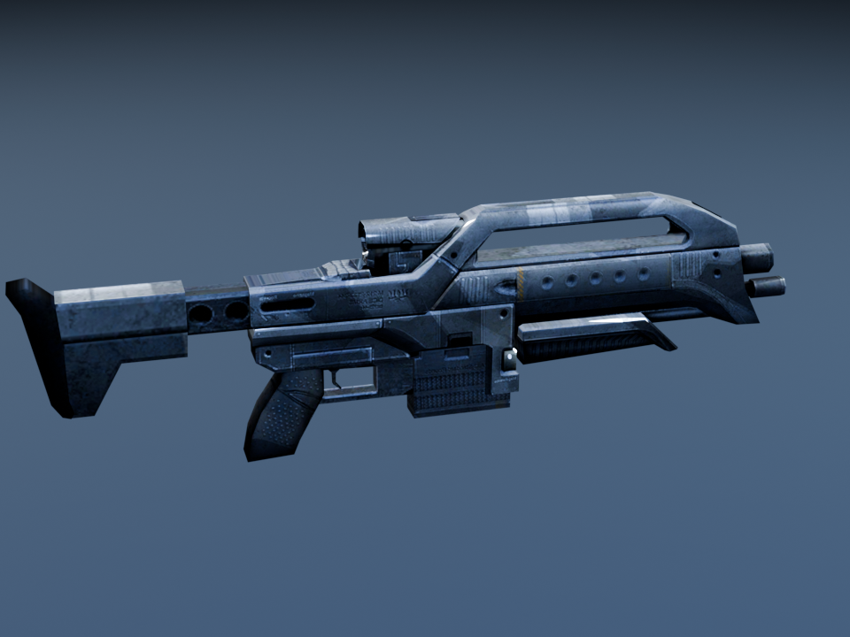
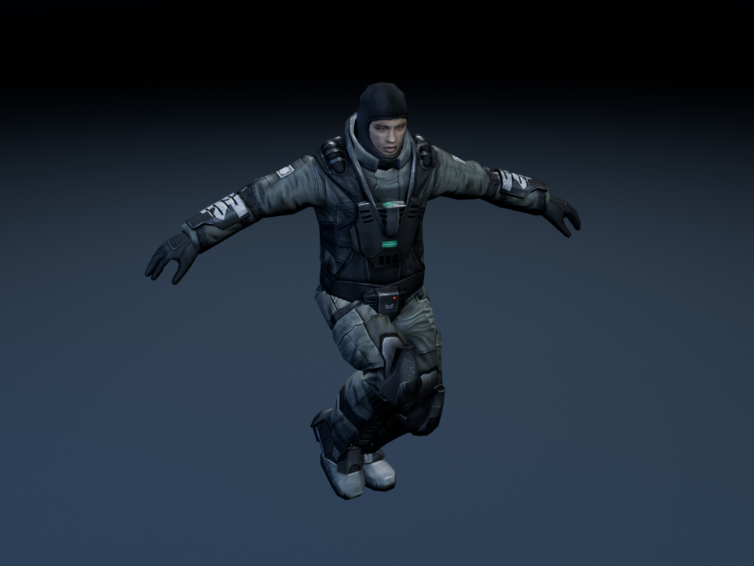
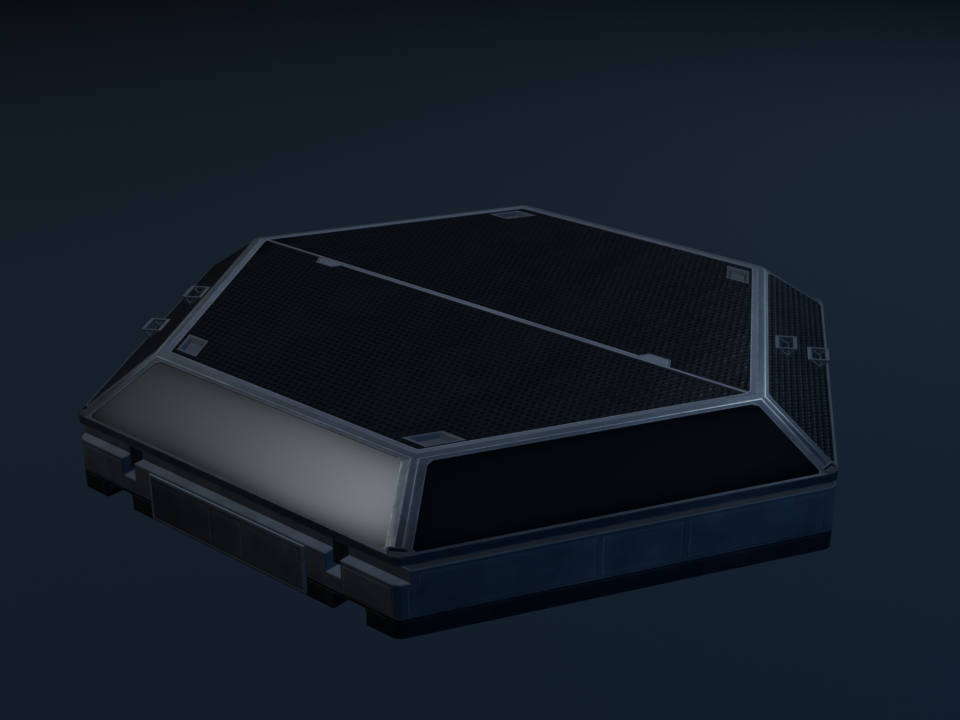
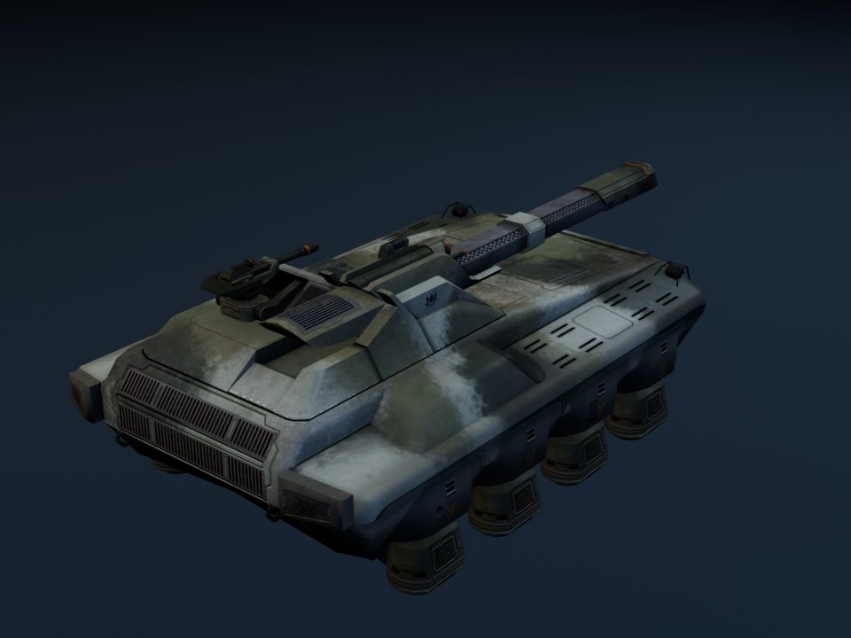

# Battlefield 2142 Notes

Battlefield 2142 uses the same broad Refractor 2 asset families as
Battlefield 2, but its retail archive layout and some material conventions
differ. The normal import and export documentation applies unless this page
states otherwise.

## Installation setup

In the add-on preferences, set **Battlefield 2142** to the game installation
folder containing `BF2142.exe`. Do not select the `mods` directory or the
`bf2142` mod directory directly.

The add-on derives the retail asset root automatically:

```text
<Battlefield 2142 installation>/mods/bf2142
```

Battlefield 2 and Battlefield 2142 installations can be configured at the
same time. Import defaults for collision meshes, occluders, LODs, and damage
states are shared between both games. When an imported file is inside a
configured mod, that mod is searched before the other configured game so
similarly named resources resolve from the selected asset's game.

Use **Additional mod directories** for custom BF2142 mods or dependencies
outside the retail `mods/bf2142` directory.

## Retail archive layout

A stock installation normally has this structure:

```text
mods/bf2142/
    ClientArchives.con
    ServerArchives.con
    Objects/
        Common_client.zip
        Common_server.zip
        ...
        Vehicles_client.zip
        Vehicles_server.zip
        *_bp1_client.zip
        *_bp1_server.zip
    Levels/
        <level>/
            client.zip
            server.zip
```

Unlike layouts that mount all object archives directly at `Objects`, BF2142
mounts category archives below paths such as `Objects\Common`,
`Objects\StaticObjects`, and `Objects\Vehicles`. The add-on preserves those
nested mount paths when loading ObjectTemplates, meshes, and textures.

The `*_bp1_*` archives contain Northern Strike content. They are mounted by
the retail `ClientArchives.con` and `ServerArchives.con` files automatically;
do not add individual ZIP files to the preferences.

Packed level import reads these archives directly. Extraction is needed only
for workflows that select individual files and require neighboring loose
resources, such as an ObjectTemplate `.con` file with its `Meshes` directory
or animation-wizard assets. Blender's file browser cannot select a file from
inside a ZIP archive.

## Rendered examples

These Blender 5.2 renders were imported from retail BF2142 assets:

| PAC assault rifle | PAC light soldier |
| --- | --- |
|  |  |
| **Freezer StaticMesh** | **PAC hover tank** |
|  |  |

The character combines the PAC third-person SkinnedMesh with
`3p_setup.ske` and `3p_runforward.baf`. The freezer uses
`BaseDetailNDetailenvmap`, so its render demonstrates the supported base,
detail, and normal-map portion of that technique. The hover tank was imported
from its ObjectTemplate and automatically selected the intact Geom1 state.

## Verified retail formats

The following versions have been observed in retail BF2142 data:

| Asset | Observed BF2142 versions | Import status | Exported version |
| --- | --- | --- | --- |
| StaticMesh | 4, 10, 11 | Supported | 11 |
| BundledMesh | 6, 10 | Supported | 10 |
| SkinnedMesh | 4, 11 | Supported | 11 |
| CollisionMesh | 0.8, 0.9, 0.10 | 0.9 and 0.10 supported; 0.8 unsupported | 0.10 |
| Skeleton | 2 | Supported | 2 |
| Animation | 4 | Supported | 4 |
| Occluder planes | 0.2 | Supported | 0.2 |
| Compiled terrain | `0x0001001A` | Supported | Not exported |
| Compiled roads | 0.0, 1.0, 1.2, 1.3, 1.4 | Supported | Not exported |

Importing an older mesh does not make the exporter preserve its original
container version. Export uses the current versions listed above.

### CollisionMesh 0.8 limitation

Some retail BF2142 assets contain CollisionMesh version `0.8`, whose layout is
older than the supported `0.9` and `0.10` layouts. Importing one of these files
directly currently fails. Importing an ObjectTemplate with **Import Collision
Meshes** set to **On** or **Hidden** can also fail when that object references a
version `0.8` CollisionMesh.

The shared default is **Off**, so this limitation does not prevent the visible
mesh from being imported when collision data is not requested.

### Bundle-skeleton ObjectTemplate limitation

Some BF2142 vehicles, including the PAC and EU battle walkers, use
`ObjectTemplate.bundleSkeleton` and child `ObjectTemplate.boneIndex` commands
to define the rest placement of articulated geometry. The individual
ObjectTemplate importer does not currently apply that bundle-skeleton pose.
The template can import, but its geometry parts may not assemble into their
in-game rest positions. The BundledMesh and skeleton files remain available
for separate import.

## Material differences

### StaticMesh `envmap` techniques

Some BF2142 StaticMeshes use techniques such as
`BaseDetailNDetailenvmap`. The add-on imports the base, detail, and normal-map
portion of these materials, but does not currently reproduce the Refractor
StaticMesh environment-map reflection. A warning is reported during a
non-silent import, and the material remains otherwise usable in Blender.

The existing `parallaxdetail` limitation also applies: the base material is
imported without the Refractor parallax effect.

### Mesh and FX shader mismatches

A small number of retail BF2142 effect assets intentionally reference an FX
shader that does not match their mesh container:

- BundledMesh files may declare `StaticMesh.fx` or `SkinnedMesh.fx`.
- StaticMesh files may declare `BundledMesh.fx`.

The importer handles these known cases for display. BundledMesh containers
continue to use BundledMesh material behavior. A StaticMesh that declares
`BundledMesh.fx` uses BundledMesh material behavior so its color and normal
maps can be represented.

The exporter requires the Blender material shader type to match the target
mesh container. Before re-exporting one of the exceptional StaticMeshes,
change the material to a valid StaticMesh shader technique and verify its
texture slots.

## Level import

Stock BF2142 maps use the same packed-level entry points as Battlefield 2:

```text
mods/bf2142/Levels/<level>/client.zip
mods/bf2142/Levels/<level>/server.zip
```

The shared **Level / Map** operator supports BF2142 terrain, surrounding
terrain, static objects, overgrowth, compiled roads, water, and lighting.
The visual-only limitations listed in the
[level and map import guide](MAP_IMPORT.md#current-limitations) also apply to
BF2142. Gameplay systems, AI/navigation, particles, sounds, destruction, and
the full Refractor sky and fog systems are not reconstructed.

## Troubleshooting

### The preferences report a missing asset directory

Select the installation folder containing `BF2142.exe`. The add-on expects
`mods/bf2142` below that folder.

### An individual asset has missing textures or related files

Confirm that the asset is inside the configured `mods/bf2142` directory or an
additional mod directory. If the asset was extracted elsewhere, either
preserve its engine-relative directory structure or add that mod root under
**Additional mod directories**.

### A stock ObjectTemplate cannot be selected

Retail ObjectTemplates are normally stored inside the server archives.
Complete level import can read them in place. To use the individual
ObjectTemplate importer, extract the `.con` file and its neighboring mesh and
texture resources while preserving their relative paths.

### A material reports an unsupported environment map

This refers to the BF2142 StaticMesh `envmap` technique described above. The
remaining material maps are imported; only the engine-specific reflection is
omitted.

### A CollisionMesh import fails

Check its version. Retail BF2142 includes version `0.8` CollisionMeshes, which
are not currently supported. Versions `0.9` and `0.10` are supported. Leave
**Import Collision Meshes** set to **Off** when importing an ObjectTemplate
that references an affected file.
